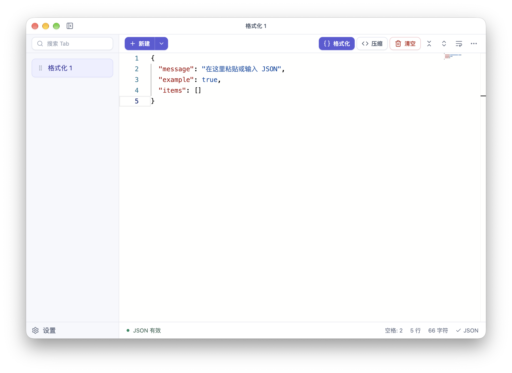
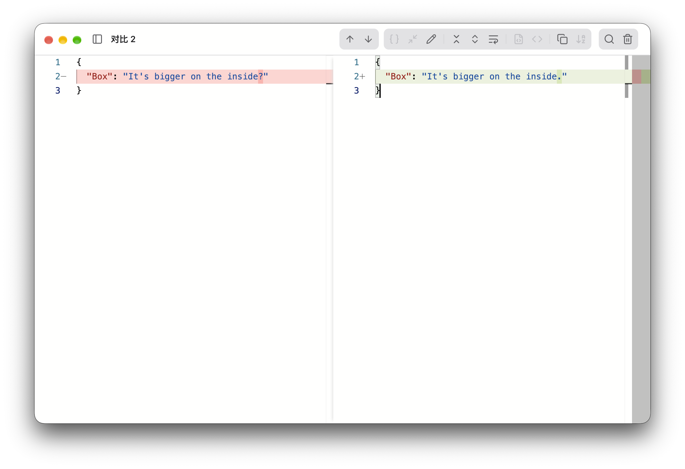

> 🚧 项目处于开发阶段，仅在MacOS经过测试

# JSONPal

这是一款基于Electron的JSON工具，支持编辑、格式化和差异对比。


## 功能预览

JSON 编辑与格式化



JSON 差异对比



## 下载安装

前往**Releases**页面下载对应平台的版本。

| 平台 | 安装包 |
|---|---|
| macOS | DMG |
| Windows | EXE 安装版 / Portable 便携版 |
| Linux | AppImage / tar.gz |

## 本地开发

安装依赖：

```bash
npm install
```

启动开发环境：

```bash
npm run dev
```

构建应用：

```bash
npm run build:mac
npm run build:win
npm run build:linux
```

## 致谢

项目的功能与交互设计均源自于 [zjson](https://github.com/CN-Tower/zjson)，感谢作者的开源。git push origin v0.1.1